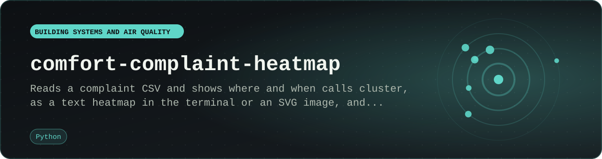
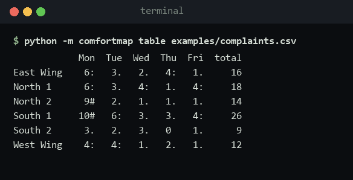

<p align="center"></p>

# comfort-complaint-heatmap

[](https://github.com/yassine2med/comfort-complaint-heatmap/actions/workflows/ci.yml)  

Occupant comfort calls (too hot, too cold, stuffy, drafty) pile up in a log and nobody sees the pattern. This tool reads a complaint CSV and shows where and when calls cluster, as a text heatmap in the terminal or an SVG image, and ranks zones by hot versus cold balance.



## What it is for

Facility coordinators and building engineers get comfort calls all day. A zone that is always too hot on Monday mornings, or a side of the building that is always too cold, points at a setpoint, schedule or airflow problem. Use this tool to turn the call log into evidence before sending a technician or changing a schedule.

## Install

```
git clone https://github.com/yassine2med/comfort-complaint-heatmap
cd comfort-complaint-heatmap && pip install -r requirements.txt
```

## How to use

| I want to | Command |
|---|---|
| Heatmap of all complaints by zone and weekday | `PYTHONPATH=src python -m comfortmap table examples/complaints.csv` |
| Only hot calls, by hour of day | `PYTHONPATH=src python -m comfortmap table examples/complaints.csv --kind hot --by hour` |
| Hot versus cold balance per zone | `PYTHONPATH=src python -m comfortmap zones examples/complaints.csv` |
| Draw the heatmap as an SVG image | `PYTHONPATH=src python -m comfortmap svg examples/complaints.csv -o heatmap.svg` |
| Exit 1 if any row had to be skipped | `PYTHONPATH=src python -m comfortmap table examples/complaints_with_errors.csv --strict` |
| Show help | `PYTHONPATH=src python -m comfortmap --help` |

Example:

```
PYTHONPATH=src python -m comfortmap table examples/complaints.csv
```

Output:

```
            Mon  Tue  Wed  Thu  Fri  total
East Wing    6:   3.   2.   4:   1.     16
North 1      6:   3.   4:   1.   4:     18
North 2      9#   2.   1.   1.   1.     14
South 1     10#   6:   3.   3.   4:     26
South 2      3.   2.   3.   0    1.      9
West Wing    4:   4:   1.   2.   1.     12
```

Run the tests with `python -m pytest -q`.

## How it works

1. The CSV needs three columns: timestamp (YYYY-MM-DD HH:MM), zone and kind (Too Hot, Too Cold, Stuffy or Drafty).
2. Rows with a bad timestamp, an empty zone or an unknown kind are skipped and named on stderr.
3. Complaints are counted per zone and weekday (Monday to Friday) or per hour. Each cell shows its count and a shade from space to #.
4. `zones` counts Too Hot minus Too Cold per zone and sorts by the largest gap.
5. `svg` draws the same grid as coloured cells, written with the standard library only. The sample data is invented.

## Limits

- Weekday view ignores Saturday and Sunday calls.
- It counts calls, not people: three calls from one person count three times.
- It shows patterns, not causes.

## License

MIT. Yassine Emhamed, 2026.
